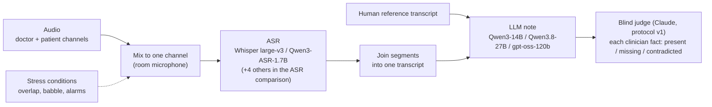
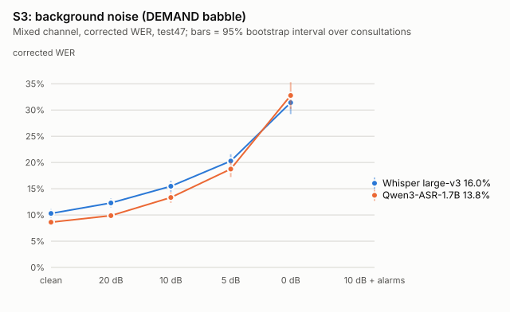

# medical-asr-eval: is the bottleneck in listening or in writing?

An evaluation of open-weight speech recognition (ASR) and local LLM note writing on PriMock57 mock GP consultations: how much does each stage cost the final clinical note, in quiet and in noise?

**Short answer**: in quiet audio, the note-writing model matters far more than the ASR. In loud speech babble (0 dB), the ASR's cost catches up with the generation model's. Which stage is the bottleneck depends on the acoustic conditions. Averages also hide dangerous single errors, such as "Do you smoke? No." becoming "Smokes" in the note.

## 1. Motivation

The target setting is automatic documentation in a trauma bay: several clinicians talking at once, alarms, far-field microphones, and decisions that depend on single words such as "no". Real trauma-bay recordings with reference transcripts are not publicly available, so this project uses **PriMock57** as an open stand-in:

- 57 mock primary-care consultations, each with the doctor and the patient recorded on **separate channels**, verbatim reference transcripts with timestamps, and the clinician's own note.
- Licence **CC BY 4.0**.
- **Limits as a stand-in**: two speakers, not a team; a quiet video call, not a resuscitation room; British accents; actors playing patients from case cards. The stress test (section 3.2) adds overlap and noise synthetically to push towards the target setting, but does not reproduce it.

## 2. Pipeline

- **ASR** runs locally (RTX 5080 laptop GPU). Notes are generated with Ollama on rented A100 80GB GPUs. The judge is Claude through the Claude Code CLI.
- The **human reference transcript** goes through the same note writer, so every ASR note has a paired "perfect listening" note.
- The **mixed single channel** is the main ASR input: one room microphone, no speaker labels.

## 3. Main findings

All intervals are 95% paired bootstrap intervals over consultations (10,000 resamples). "Recall" is **stated-fact recall**: the share of the clinician's note facts that were actually said in the consultation and appear correctly in the generated note (section 4).

### 3.1 In quiet audio, the bottleneck is the note writer

| Comparison (25 test consultations) | Recall difference |
|---|---|
| **Generation model**: Qwen3.8-27B − Qwen3-14B, from the human transcript | **+12.1 [+7.8, +16.4]** |
| Generation model: gpt-oss-120b − Qwen3-14B, from the human transcript | +7.6 [+4.4, +10.9] |
| **ASR**: Whisper transcript − human transcript, pooled over the three generation models | **−2.6 [−4.6, −0.7]** |
| ASR: Qwen3-ASR transcript − human transcript, pooled | −1.2 [−2.6, +0.3] |
| Regeneration noise: same model and transcript, regenerated on a different GPU (14B) | −0.7 [−3.0, +1.6] |

- Swapping the generation model moves recall by 8–12 points; swapping a perfect transcript for an ASR transcript moves it by 1–3 points, comparable to the noise from regenerating the same note on different hardware.
- **Limitations**: 25 consultations; quiet telehealth audio; three generation models chosen as representatives, not a size ladder (different families and quantisation). Details: `docs/stage3-grid-results.md`.

### 3.2 In 0 dB babble, the ASR's cost matches the generation model's

Qwen3.8-27B notes on the same 25 consultations, with DEMAND cafeteria/restaurant babble added to the mixed channel at a fixed SNR; the human-transcript column was regenerated in the same session.

| Source | Corrected WER (47 consultations) | Stated-fact recall | vs human transcript |
|---|---|---|---|
| Human transcript | — | 89.3% | — |
| 5 dB, Whisper / Qwen3-ASR | 20.3% / 18.8% | 83.5% / 83.5% | −5.9 [−8.8, −2.6] / −5.9 [−8.6, −3.3] |
| 0 dB, Whisper / Qwen3-ASR | 31.4% / 32.8% | 75.0% / 75.1% | **−14.4 [−18.8, −9.8] / −14.2 [−17.1, −11.0]** |

- At 0 dB the ASR costs about as much recall as the 27B − 14B generation-model gap (+12.1 [+7.8, +16.4]); at 5 dB about half. Contradicted facts rise from 1.6% to 6–8%.
- Lost facts sit in stretches the ASR dropped (about three times as often in mostly deleted utterances as kept facts); contradicted facts sit where it misheard. The mapping is not clean: deleting one "no" also produces a contradiction.
- **Limitations**: synthetic babble from two public recordings, not a trauma bay; one generation model at the note level; 25 consultations. Overlap stress (up to 3× the natural overlap) raised WER by only about 3 points and was not taken to the note level. Third speakers and far-field reverberation were not tested. Details: `docs/stress-test.md`.

### 3.3 WER gaps do not carry through to the notes

| Condition | Qwen3-ASR − Whisper, corrected WER | Qwen3-ASR − Whisper, note recall |
|---|---|---|
| Quiet (pooled over 3 generation models) | −1.67 [−2.09, −1.27] | +1.4 [−0.3, +3.3] |
| 5 dB babble (27B) | −1.53 [−2.13, −0.94] | +0.0 [−3.7, +3.4] |
| 0 dB babble (27B) | **+1.37 [+0.48, +2.31]** | +0.2 [−4.1, +4.4] |

- Qwen3-ASR has the lowest WER of six ASR systems in quiet audio (section 3.4), and Whisper beats it at 0 dB, yet the notes end level in all three conditions. A WER ranking does not predict the effect on the note.
- **Limitations**: the note-level intervals are wide (25 consultations), so small real differences cannot be ruled out. One exception in quiet audio: with gpt-oss-120b, Qwen3-ASR notes are ahead by +3.4 [+1.3, +5.3].

### 3.4 Overlapping speech: the speaker who comes in is dropped, whatever the ASR

Mixed channel, 47 test consultations, deletion rate of words spoken while both people talk:

| ASR | In overlap | Speaker who came in | Speaker holding the turn |
|---|---|---|---|
| Qwen3-ASR-1.7B | 20.3% | 29.1% | 12.9% |
| Canary-Qwen 2.5B | 21.3% | 31.3% | 12.8% |
| Cohere Transcribe | 22.3% | 31.2% | 14.8% |
| Parakeet TDT 0.6B v2 | 22.7% | 32.4% | 14.5% |
| Whisper large-v3 | 25.3% | 34.4% | 17.5% |
| Granite Speech 4.1 2B | 30.3% | 38.2% | 23.5% |

- All six models delete the incoming speaker about twice as often as the one already talking. A better ASR lowers the level but keeps the pattern; changing ASR does not fix it. Outside overlap, Whisper and Qwen3-ASR delete 3–4% of words.
- In the stress test, tripling the amount of overlap raised the number of deleted words but not the per-word deletion rate inside overlap.
- **Limitations**: no interval is given for the role split; roles are defined from reference timestamps; synthetic overlap only time-shifts recordings and does not change how people speak.

### 3.5 Default decoding settings exaggerate hallucination, and much of WER is not real error

Whisper large-v3 on 10 development consultations:

| Setting | Patient-channel WER | Long insertion runs (words), patient / mixed |
|---|---|---|
| faster-whisper defaults | 34.6% | 32 (1,064) / 17 (387) |
| + VAD | 18.8% | 9 (195) / 24 (481) |
| + VAD, no conditioning on previous text | **14.6%** | **0 / 0** |

- Most "hallucination" in the default setting is the decoder feeding its own output back as context and looping. With conditioning off, long insertion runs disappear. Reports of Whisper hallucination should state the decoding settings.
- On the test set (mixed channel, 12.5% raw WER for Whisper), **2.2 points** are normaliser artefacts ("okay" vs "ok", "O.K." becoming "0 k"; removed by a fixed equivalence table, giving corrected WER) and **up to 3.5 points** fall on reference words the transcribers themselves marked as uncertain. Together, up to about 45% of the raw WER is not a recognition error.
- **Limitations**: the decoding comparison is on 10 consultations without intervals; the uncertain-reference share is an upper bound and is not subtracted from any reported WER.

### 3.6 Averages hide dangerous single errors

| Case | Said | ASR | Note |
|---|---|---|---|
| Fluent wrong answer (0 dB) | Doctor: "And do you smoke?" Patient: "No." | Qwen3-ASR: "Do you smoke? **Yeah.**" (Whisper correct) | "Smokes" |
| Term error becomes a claim (5 dB, 0 dB) | "I have N, N, NK, NKDA allergy" (no known drug allergies) | Qwen3-ASR: "an **KBA** allergy" / "an **aneka** allergy" | "Allergy to KBA" |
| Meaning flip (quiet) | "…but I **wasn't** drinking a lot these days" | Both Whisper and Qwen3-ASR: "but I'm **also** drinking a lot" | "attributed to increased fluid intake" (14B, 27B and gpt-oss) |
| Invented negative (no ASR involved) | Headache with photophobia; the neck was never asked about | — (human transcript) | "No … **neck stiffness**" (gpt-oss) |

- An LLM-based ASR can turn a word masked by noise into a fluent, confident answer, which is hard to spot on review. Generation models also add negative findings that were never discussed (2.4–3.5 per note on average), including red flags such as neck stiffness for a headache.
- Each of these changes a fact in a note while moving recall by a fraction of a point.
- **Limitations**: cases were found by screening and checked by hand; they show what can happen, not how often. Lists: `results/notes/grid/key_cases.md`, `docs/stress-test.md` §5.3–5.4.

## 4. Methods

- **Data split**: development set = 10 consultations (`data/prepared_full10`), used to choose ASR settings and validate stress synthesis. Test set = the other 47, run once with fixed settings. The note grid uses 25 test consultations drawn with seed 0 (`results/notes/test47/grid_ids.txt`).
- **ASR settings**: Whisper large-v3 with VAD and no conditioning on previous text; Qwen3-ASR-1.7B on a shared chunk plan (≤ 30 s, cut at pauses, `scripts/plan_chunks.py`). Six ASR systems (eight runs) were compared in quiet audio (`results/test47/asr_selection.md`).
- **Normalisation (frozen)**: the Whisper English normaliser on reference and hypothesis, then a fixed equivalence table for the normaliser's inconsistencies (corrected WER). Raw WER is also reported.
- **Note generation**: prompt v3 (rules in the system message), temperature 0, seed 0, thinking off (gpt-oss: lowest reasoning effort), Ollama 0.40.11, 16k context. `scripts/generate_notes.py`.
- **Judge protocol v1 (frozen)**: Claude, via `claude -p` with JSON-schema output and no tools.
  1. The clinician's note is split once into atomic facts (725 facts over 25 consultations); every candidate note is scored against the same list.
  2. Each fact is labelled present / missing / contradicted in the candidate note; the candidate's own extra claims are also listed.
  3. The judge never sees the transcript or which source or model produced the note; jobs run in shuffled order.
- **Stated-fact recall (primary)**: 162 of the 725 facts were never said, or only partly said, in the consultation (`scripts/check_facts_stated.py`); no transcript can supply them. Recall is computed on the remaining 563 stated facts. **All-fact recall** is reported as a supplement and gives the same conclusions.
- **Statistics**: paired bootstrap over consultations, the same resamples for every system, 95% percentile intervals (`scripts/bootstrap_asr.py`, `scripts/compare_notes.py`).

## 5. Noise and variance

- **Regenerating on different hardware flips about 7% of judgements.** The same 14B model, transcript, prompt and seed, run locally and on an A100, changed 6.8% of stated-fact labels; greedy decoding is not bit-identical across GPUs. The recall difference was −0.7 [−3.0, +1.6].
- **Regenerating in the same environment changes almost nothing**: the stress-test session regenerated the 27B human-transcript column on the same GPU type and Ollama version as the grid; 2 of 563 labels differed (0.4%).
- **Judging again changes little**: re-judging unchanged notes moved pooled recall by +0.2 [−0.7, +1.1].
- **Therefore every comparison is made within one environment**: each grid column was generated in one rental session, and the stress-test notes were compared with a human column regenerated in the same session.

## 6. Limitations

- **Two-person consultations are not a trauma bay**: no teams, few interruptions, quiet rooms, telehealth audio.
- **Synthetic stress**: overlap is made by time-shifting real utterances; noise comes from two public babble recordings plus three alarm sounds. Each factor was varied alone.
- **The reference transcripts contain errors**: transcribers marked over 1,100 stretches as uncertain; some "ASR errors" are reference errors (section 3.5).
- **The judge is an LLM**: protocol v1 is fixed and blinded, re-judging is stable, and a manual spot check of its labels has been prepared but not yet completed.
- **Sample size**: 47 consultations at the ASR level, 25 at the note level; differences of 1–2 recall points cannot be resolved.
- **Mixed channel only in the note grid**: separated-channel notes would need word timestamps that Qwen3-ASR does not output by default.

## 7. Next steps

- **Real multi-speaker data**: recordings with several clinicians, alarms and distance.
- **Who said what**: target-speaker ASR (e.g. DiCoW) or speech separation before recognition, aimed at the incoming speaker in overlaps.
- **Medical-domain fine-tuning** of the ASR, judged by its effect on notes rather than WER alone.
- **Semantic metrics** that weight negations, drugs and allergies rather than counting all words equally.
- **Flag high-risk content for review**: negations and allergies recognised with low confidence, or answers produced under noise, highlighted for a human.
- **Not "denoise first"**: denoising before medical ASR made results worse in all 40 configurations tested by Chondhekar et al. (arXiv 2512.17562), so stress conditions go straight into the ASR.

## 8. Reproduction

### Environment

- Separate Python virtual environments per toolkit (Whisper/analysis, Qwen3-ASR, NeMo, …); see `docs/smoke-test-setup.md` for the exact environments and versions. Always run Python with `-I`.
- ASR on one 16 GB GPU (RTX 5080 laptop); notes on one A100 80GB (`scripts/setup_note_server.sh`); judging needs the Claude Code CLI (`--claude`, or `$CLAUDE_BIN`, or `claude` on PATH).

### Order of scripts

| Step | Scripts |
|---|---|
| Data | `download_data.py` (clones PriMock57, fetches LFS audio with checksums) → `prep_data.py` (per consultation: doctor, patient and mixed wav; references; `utterances.json`) |
| ASR | `plan_chunks.py` (shared chunk plan) → `transcribe.py` (faster-whisper, Qwen3-ASR, Parakeet, …) |
| ASR analysis | `evaluate.py` (raw and corrected WER) → `error_composition.py`, `analyze_overlap.py`, `analyze_negations.py`, `count_repeats.py` → `bootstrap_asr.py` |
| Notes | `generate_notes.py` (`run_grid.sh` on the server) |
| Judging | `judge_notes.py` → `check_facts_stated.py` → `compare_notes.py --stated` → `combine_grid.py`, `plot_grid_heatmap.py`, `recall_definitions.py` |
| Stress test | `stress_overlap.py`, `stress_noise.py` (configs in `configs/stress/`) → `run_stress_asr.ps1` → `run_stress_analysis.ps1` → `stress_summary.py`; notes: `run_stress_notes.sh` → `attribute_note_errors.py` |
| Inspection | `make_viewer.py` (audio + transcripts side by side, `results/viewer-test47/`) |

Each script documents its usage at the top. Synthesis uses fixed seeds; existing outputs are skipped, so runs resume after interruption.

### Data and licences

- **Code and documentation**: MIT (`LICENSE`).
- **PriMock57**: https://github.com/babylonhealth/primock57, CC BY 4.0; please cite its papers (arXiv 2204.00333, 2204.00447). Audio is not stored in this repository. Result files that quote its transcripts and clinician notes are derived from it under the same attribution.
- **Stress-test noise**: DEMAND (Thiemann et al., 2013; Zenodo 1227121) and three CC0 Freesound alarm recordings, mixed locally and not redistributed; links and licences in `docs/stress-test.md`.
- **Models**: Whisper large-v3 (MIT), Qwen3-ASR-1.7B (Apache 2.0); generation models from Ollama under their own licences.
