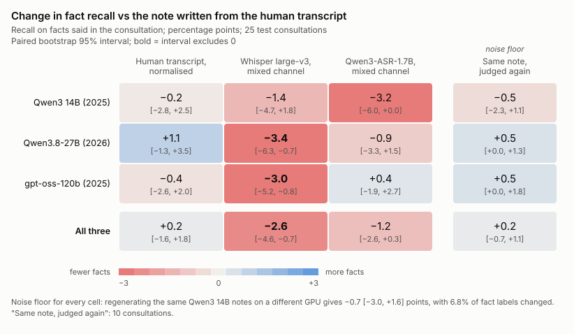

# 第三阶段：病历网格（生成模型 × 转写来源）

日期：2026-10-27。

网格的设计：
- **行**：四种转写来源，都用合并声道。
- **列**：三个生成模型。
- **样本**：每格 25 段测试集问诊。名单在 `results/notes/test47/grid_ids.txt`，从测试集 47 段里用固定种子 0 抽取。
- **评判**：冻结的 judge v1，事实清单直接用测试集已缓存的那份。

## 1. 设置

### 生成模型（纵轴：生成模型）

| 生成模型 | 发布 | 家族 / 代际 | 参数 | 量化 | 思考 |
|---|---|---|---|---|---|
| Qwen3 14B（`qwen3:14b`） | 2025-04 | Qwen3 | 14.8B，稠密 | Q4_K_M | 关闭 |
| Qwen3.8-27B（`qwen3.8:27b-q4_K_M`） | 2026-08 | Qwen3.8（Qwen3 之后的第三次大版本更新：3.5、3.6、3.8） | 27.3B，稠密 | Q4_K_M | 关闭 |
| gpt-oss-120b（`gpt-oss:120b`） | 2025-08 | OpenAI gpt-oss | 117B MoE，激活 5.1B | MXFP4（原生） | **无法关闭，设为最低强度 `low`** |

**代际混淆**：这三个模型的家族、代际、架构都不同。按公开综合排名，2026 年的 Qwen3.8-27B 高于 2025 年的 gpt-oss-120b。所以纵轴叫"生成模型"，不叫"模型大小"。列与列之间的差异，不能解读成参数量的效应。

**gpt-oss 的思考设置**：gpt-oss 的思考关不掉，最低只能设为 `low`。这和另两列"关闭思考"的原则不一致。
- 思考内容不进入病历，但单独记录。
- 每份思考约 360 个字符（中位数），最多 1,307 个。

**运行环境**：
- **三列都在租用的 A100 80GB 上用 Ollama 0.40.11 生成**，调用同一个 `generate_notes.py`，走 `/api/chat`。生成参数相同：
  - 提示词版本 v3
  - 温度 0、种子 0
  - 上下文 16384
- **两台机器**：
  - 14B 和 27B 在一台 A100 PCIe 上（系统盘只有 50 GB）；
  - gpt-oss 的权重是单个 65 GB 文件，放不下，所以在另一台 A100 SXM4 上跑。
  - 两台是同一代 GA100 芯片，Ollama 版本相同。
- **执行方式**：脚本是 `scripts/run_grid.sh`，在服务器上用 nohup 跑，本机断网不影响。

**为什么 14B 这一列在服务器上重新生成**：同一个 `qwen3:14b`（权重哈希和本机相同），在服务器上生成的病历与本机的旧病历不完全相同。原因是换显卡后浮点误差会让贪心解码在某处分叉。所以测试集那一轮的旧 14B 病历不复用，网格里三列都在 A100 上生成。这两次生成之间的差异，正好用来量化"重新生成噪声"（见 2.2）。

### 转写来源（横轴）

| 行 | 内容 |
|---|---|
| `human` | 人工转写，带说话人标签 |
| `human_plain` | 人工转写，套用 Whisper 规范化器（小写、无标点、无填充词）：只改写法的对照 |
| `asr_mixed` | Whisper large-v3 合并声道（`test47-vad-nocond`），无说话人标签 |
| `asr_mixed_qwen3asr` | Qwen3-ASR-1.7B 合并声道，无说话人标签 |

**评判噪声对照**：每列另外把 10 段的 `human` 病历原样再评一次（`human_rejudge`），名单在 `grid_rejudge_ids.txt`。

### 用时和用量

| 项目 | 用时 |
|---|---|
| 服务器 1（14B + 27B，200 份） | 约 1.4 小时，其中 27B 每份约 25 秒 |
| 服务器 2（gpt-oss，100 份） | 约 1 小时，每份约 25 秒 |
| Claude 评判 | 330 次 |

评判在本机调用 `claude -p`，每次约 16 秒，没有碰到用量上限。

## 2. 结果

### 2.1 主指标：说过的事实上的召回

| 指标 | 分子 | 分母 | 地位 |
|---|---|---|---|
| **说过的事实上的召回** | 病历里有的事实 | 谈话里明确说过的事实（`facts_stated.csv` 状态为 stated） | **主指标**，全文统一使用 |
| 全部事实上的召回 | 病历里有的事实 | 临床医生病历的全部事实 | 补充 |

**为什么用"说过的事实"作主指标**：临床医生病历里约五分之一的事实（725 条里有 162 条），谈话里没说过或只说了部分。不管转写多准确，病历都不可能写出这些事实。把它们留在分母里，只会给所有格子加上同一块"不可能得分"的部分，冲淡转写来源和生成模型之间的差别。

**78.8% 和 69.1% 不矛盾**：测试集那一轮报告的 78.8% 是说过的事实上的召回；第三阶段初稿用的 69.1% 是全部事实上的召回。两者的差别完全来自分母不同，和问诊子集、生成环境都无关：

| 运行 | 问诊数 | 事实数 | 全部事实上的召回 | 说过的事实数 | **说过的事实上的召回** |
|---|---|---|---|---|---|
| 测试集 14B，本机 RTX 5080，全部 47 段 | 47 | 1408 | 68.3% | 1059 | **78.8%** |
| 测试集 14B，本机 RTX 5080，只取网格的 25 段 | 25 | 725 | 69.1% | 563 | 78.3% |
| 网格 14B，A100（重新生成） | 25 | 725 | 69.1% | 563 | **77.6%** |

计算脚本：`scripts/recall_definitions.py`。

### 2.2 噪声底：解释所有病历层差值的基准

**重新生成噪声**：同一批 25 段，人工转写，14B 在本机 RTX 5080 和 A100 上各生成一次，再分别评判。两次的差异就是"换一次环境、重新生成"的噪声：

| 事实范围 | 判定改变的比例 | 有 → 无 | 无 → 有 | 召回差值（A100 − 本机） |
|---|---|---|---|---|
| **说过的事实**（563 条） | 6.8% | 21 | 17 | **−0.7 [−3.0, +1.6]** |
| 全部事实（725 条） | 7.2% | 25 | 25 | 0.0 [−1.9, +1.9] |

**本文把约 ±2 个百分点作为所有病历层差值的噪声底。** 配对 bootstrap 的区间只反映"换一批问诊"的抽样波动，没有包含"同一段问诊重新生成一次病历"的波动。所以：

- 一个差值即使区间不含 0，只要绝对值在 2 个百分点左右，也只能说"与重新生成噪声相当"；
- 明显超出噪声底的差值，才算实质差异。

**评判噪声**：同一份病历原样再评一次（每列 10 段）。说过的事实上的召回差值，三列合并是 +0.2 [−0.7, +1.1]，比重新生成噪声小得多。

噪声底的数据在 `results/notes/grid/regeneration_noise.csv`。

### 2.3 每格的召回

格内是"说过的事实上的召回 / 全部事实上的召回"，括号内是矛盾事实占全部事实的比例。每格说过的事实 563 条，全部事实 725 条。

| 来源 | Qwen3 14B | Qwen3.8-27B | gpt-oss-120b |
|---|---|---|---|
| 人工转写 | **77.6%** / 69.1%（3.7%） | **89.7%** / 79.9%（5.1%） | **85.3%** / 77.0%（6.5%） |
| 人工转写，只改写法 | **77.4%** / 68.0%（5.1%） | **90.8%** / 81.0%（5.2%） | **84.9%** / 76.4%（5.5%） |
| Whisper 合并 | **76.2%** / 67.2%（5.2%） | **86.3%** / 77.8%（5.7%） | **82.2%** / 74.8%（6.6%） |
| Qwen3-ASR 合并 | **74.4%** / 67.6%（5.5%） | **88.8%** / 79.7%（5.2%） | **85.6%** / 77.8%（5.7%） |
| 人工转写，再评一次（10 段） | 78.5% / 65.7%（2.5%） | 94.0% / 78.7%（4.0%） | 86.5% / 74.4%（5.1%） |

最后一行只有 10 段，不能和上面几行的数字直接比，只用来看配对差值。

### 2.4 热图

- 每格是相对"人工转写写成的病历"的召回差值，单位是百分点，附 95% 区间；粗体表示区间不含 0。
- 最右一列是"同一份病历再评一次"。
- 图下注明了重新生成噪声，这是读每一格时都要对照的噪声底。
- 补充图（全部事实上的召回）：`results/notes/grid/heatmap.svg`。
- 数字表：`heatmap_stated.csv`、`heatmap.csv`；脚本：`scripts/plot_grid_heatmap.py`。

### 2.5 生成模型之间

同一来源配对，以问诊为单位 bootstrap 10000 次，说过的事实上的召回，单位：百分点。

| 来源 | 27B − 14B | gpt-oss − 14B | gpt-oss − 27B |
|---|---|---|---|
| 人工转写 | +12.1 [+7.8, +16.4] | +7.6 [+4.3, +10.9] | −4.4 [−7.3, −1.4] |
| 人工转写，只改写法 | +13.3 [+9.8, +17.2] | +7.5 [+4.2, +10.8] | −5.9 [−8.7, −2.9] |
| Whisper 合并 | +10.1 [+6.3, +14.5] | +6.0 [+2.6, +9.7] | −4.1 [−7.1, −1.0] |
| Qwen3-ASR 合并 | +14.4 [+10.0, +18.5] | +11.2 [+7.1, +15.2] | −3.2 [−5.8, −0.4] |

**生成模型的影响远大于 ASR 的影响，也远大于噪声底。**

- 27B 比 14B 高 10–14 个百分点，是噪声底的 5 倍以上。
- gpt-oss 介于两者之间，比 27B 低 3–6 个百分点，四种来源下区间都不含 0。

全部事实上的召回给出相同的结论：27B − 14B 为 +10.6 到 +13.0，见 `results/notes/grid/all/paired_summary.csv`。说过的事实版本在 `paired_summary_stated.csv`。

### 2.6 ASR 来源的影响

说过的事实上的召回，相对同一生成模型、人工转写写成的病历，单位：百分点。

| 对比 | Qwen3 14B | Qwen3.8-27B | gpt-oss-120b | 三列合并 |
|---|---|---|---|---|
| Whisper − 人工 | −1.4 [−4.7, +1.8] | −3.4 [−6.3, −0.7] | −3.0 [−5.2, −0.8] | −2.6 [−4.6, −0.7] |
| Qwen3-ASR − 人工 | −3.2 [−6.0, 0.0] | −0.9 [−3.3, +1.5] | +0.4 [−1.9, +2.7] | −1.2 [−2.6, +0.3] |
| Qwen3-ASR − Whisper | −1.8 [−5.0, +1.6] | +2.5 [−0.5, +5.6] | +3.4 [+1.3, +5.3] | +1.4 [−0.3, +3.3] |
| 只改写法 − 人工 | −0.2 [−2.8, +2.5] | +1.1 [−1.3, +3.5] | −0.4 [−2.6, +2.0] | +0.2 [−1.6, +1.8] |
| *噪声底：重新生成* | | | | *−0.7 [−3.0, +1.6]* |

"三列合并"把三个生成模型的事实放在一起，仍按问诊重采样（25 个单位）。

结论：

- **Whisper 合并声道：召回损失与重新生成噪声相当。**
  - 三列合并是 −2.6 个百分点，配对区间 [−4.6, −0.7] 不含 0；在 27B 和 gpt-oss 两列单独看也不含 0。
  - 但损失的大小和重新生成噪声的区间（约 ±2 个百分点）相当，不能当作实质性的影响。
- **Qwen3-ASR 合并声道**：
  - 三列合并 −1.2 [−2.6, +0.3]，落在噪声底以内，与人工转写分不开。
  - 14B 那一列单独看是 −3.2，区间上限正好是 0，而另两列接近 0，三列方向不一致。
- **Qwen3-ASR 对 Whisper**：
  - 三列合并 +1.4 [−0.3, +3.3]，不显著；
  - 只有 gpt-oss 列 +3.4 [+1.3, +5.3] 区间不含 0，14B 列是负值。
  - 结论：两种 ASR 的 WER 差距（合并声道修正后 8.6% 对 10.3%），在病历层看不出稳定的差别。
- **只改写法**（去掉标点、大小写和填充词）：+0.2 [−1.6, +1.8]，对病历几乎没有影响。

**补充：全部事实上的召回**

| 对比（三列合并） | 全部事实上的召回差值 |
|---|---|
| Whisper − 人工 | −2.1 [−4.1, −0.1] |
| Qwen3-ASR − 人工 | −0.3 [−2.1, +1.7] |
| Qwen3-ASR − Whisper | +1.8 [−0.1, +3.8] |
| *噪声底：重新生成* | *0.0 [−1.9, +1.9]* |

结论与主指标相同。

### 2.7 矛盾事实

在说过的事实上，ASR 来源的病历比人工转写多出少量矛盾事实（三列合并，单位：百分点）：

| 对比 | 矛盾事实比例的差值 |
|---|---|
| Whisper − 人工 | +1.5 [+0.7, +2.3] |
| Qwen3-ASR − 人工 | +1.2 [+0.5, +2.0] |
| 只改写法 − 人工 | +0.5 [−0.1, +1.1] |

- 两种 ASR 都显著，但幅度只有 1–2 个百分点。
- 在全部事实上，这两项都不显著（Whisper +0.7 [−0.2, +1.7]，Qwen3-ASR +0.4 [−0.5, +1.2]）。
- 矛盾事实是病历层最直接的风险，典型例子见 2.10 的关键个案：not → also 的意思翻转。

### 2.8 病历缺失事实的归因

这一节按定义必须用**全部事实**作分母，因为"谈话里没说过"本身就是归因类别之一。分母是每格 725 条事实。

| 来源 | 生成模型 | 不在病历里 | 谈话里没说过 | 只说了部分 | 生成模型自己漏写（两份都缺） | **只因这个来源而丢失** |
|---|---|---|---|---|---|---|
| 只改写法 | 14B / 27B / gpt-oss | 32.0 / 19.0 / 23.6% | 5.7 / 5.7 / 5.0% | 6.6 / 4.3 / 5.0% | 12.1 / 4.3 / 7.0% | **4.7 / 2.2 / 4.0%** |
| Whisper 合并 | 14B / 27B / gpt-oss | 32.8 / 22.2 / 25.2% | 5.8 / 5.4 / 5.0% | 6.8 / 4.3 / 4.7% | 11.2 / 5.0 / 7.4% | **6.8 / 5.0 / 5.8%** |
| Qwen3-ASR 合并 | 14B / 27B / gpt-oss | 32.4 / 20.3 / 22.2% | 5.5 / 5.5 / 4.8% | 5.7 / 4.7 / 4.6% | 13.4 / 5.0 / 7.3% | **5.9 / 3.2 / 3.3%** |

- **"只因这个来源而丢失"的比例**（人工转写病历里有、这一份里没有）：
  - "只改写法"对照本身就有 2.2–4.7%。这部分反映的也是重新生成噪声：输入稍有不同，贪心解码就会写出不同的病历。
  - Qwen3-ASR 是 3.2–5.9%，Whisper 是 5.0–6.8%。
  - 两种 ASR 都只比这个对照高 1–2 个百分点。
- **不在病历里的事实，大部分不是转写造成的**，主要来自三处：
  - 谈话里本来就没说（约 5–6%）；
  - 只说了部分（约 4–7%）；
  - 生成模型自己漏写（14B 约 11–13%，27B 约 4–5%）。

  所以换更好的生成模型，收益比换 ASR 大。

### 2.9 多写的内容

每份病历平均多写的阴性发现（"no ..."，不一定被问过）：

| 生成模型 | 每份多写的阴性发现 |
|---|---|
| Qwen3 14B | 2.4–2.8 条 |
| Qwen3.8-27B | 2.6–3.1 条 |
| gpt-oss-120b | 3.1–3.5 条 |

在同一个生成模型内，各个来源之间差别不大。也就是说，这些多写的阴性发现主要由生成模型决定，与转写来源关系不大。临床上危险的例子见 2.10。

### 2.10 关键个案

见 `results/notes/grid/key_cases.md`，每条都带问诊编号、时间、原文和对照页面链接：

- 否定翻转：ASR 丢了否定词；
- 意思翻转：not ↔ also；
- 生成模型凭空写出的阴性发现：例如头痛加畏光的病例里写"无颈强直"。

## 3. 局限

- **样本少**：每格只有 25 段。ASR 之间的差别落在噪声底附近。
- **噪声底只来自一个模型**：重新生成噪声只在 14B、人工转写这一个格子上测过（本机对 A100）。别的格子的重新生成噪声没有单独测量，本文假设它们的大小相近。
- **只用合并声道**：Qwen3-ASR 没有词级时间戳，分声道病历这一比较没做。
- **生成模型是一组"代表"，不是一条大小阶梯**：家族、代际、架构、量化格式（Q4_K_M 对 MXFP4）都不同，而且 gpt-oss 开着低强度思考。
- **每格只生成一次**：贪心解码、固定种子。
- **评判模型与生成模型的关系**：评判用 Claude（Opus 5.5）。网格里没有 Claude 生成的病历，所以不存在"同家族自评"的偏差。
- **数据集**：PriMock57 的模拟远程问诊，参考病历由一位临床医生书写。

## 4. 文件

| 内容 | 位置 |
|---|---|
| 每列的评判结果 | `results/notes/grid/<模型>/`：`scores.csv`、`fact_labels.csv`、`summary.csv`、`paired_summary.csv`、`discordant_facts.csv`、`spotcheck.csv` |
| 每列的缺失归因和多写内容 | `results/notes/grid/<模型>/error_composition/` |
| 网格汇总表（两种召回） | `results/notes/grid/grid_summary.csv`、`grid.md` |
| 配对比较：说过的事实（主） | `results/notes/grid/all/paired_summary_stated.csv` |
| 配对比较：全部事实（补充） | `results/notes/grid/all/paired_summary.csv` |
| 重新生成噪声 | `results/notes/grid/regeneration_noise.csv` |
| 热图 | `results/notes/grid/heatmap_stated.svg`（主）、`heatmap.svg`（补充） |
| 关键个案 | `results/notes/grid/key_cases.md` |
| 病历原文 | `outputs/notes-grid/notes/<模型>/`（不提交） |
| 脚本 | `scripts/run_grid.sh`、`scripts/generate_notes.py`、`scripts/combine_grid.py`、`scripts/compare_notes.py`（新增 `--stated`）、`scripts/recall_definitions.py`、`scripts/plot_grid_heatmap.py` |
