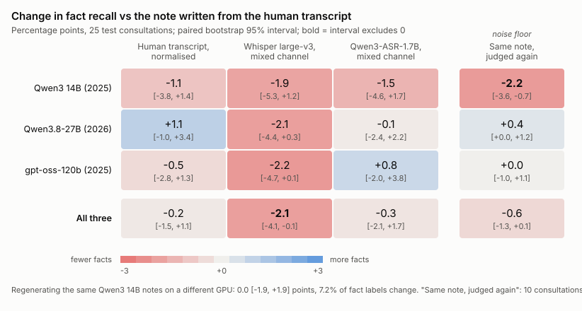

# 第三阶段：病历网格（生成模型 × 转写来源）

日期：2026-10-27。

网格的设计：
- **行**：四种转写来源，都用合并声道。
- **列**：三个生成模型。
- **样本**：每格 25 段测试集问诊。名单在 `results/notes/test47/grid_ids.txt`，从测试集 47 段里用固定种子 0 抽取。
- **评判**：冻结的 judge v1，事实清单直接用测试集已缓存的那份。

## 1. 设置

### 生成模型（纵轴：生成模型）

| 生成模型 | 发布 | 家族 / 代际 | 参数 | 量化 | 思考 |
|---|---|---|---|---|---|
| Qwen3 14B（`qwen3:14b`） | 2025-04 | Qwen3 | 14.8B，稠密 | Q4_K_M | 关闭 |
| Qwen3.8-27B（`qwen3.8:27b-q4_K_M`） | 2026-08 | Qwen3.8（Qwen3 之后的第三次大版本更新：3.5、3.6、3.8） | 27.3B，稠密 | Q4_K_M | 关闭 |
| gpt-oss-120b（`gpt-oss:120b`） | 2025-08 | OpenAI gpt-oss | 117B MoE，激活 5.1B | MXFP4（原生） | **无法关闭，设为最低强度 `low`** |

**代际混淆**：这三个模型的家族、代际、架构都不同。按公开综合排名，2026 年的 Qwen3.8-27B 高于 2025 年的 gpt-oss-120b。所以纵轴叫"生成模型"，不叫"模型大小"。列与列之间的差异，不能解读成参数量的效应。

**gpt-oss 的思考设置**：gpt-oss 的思考关不掉，最低只能设为 `low`。这和另两列"关闭思考"的原则不一致。
- 思考内容不进入病历，但单独记录。
- 每份思考约 360 个字符（中位数），最多 1,307 个。

**运行环境**：
- **三列都在租用的 A100 80GB 上用 Ollama 0.40.11 生成**，调用同一个 `generate_notes.py`，走 `/api/chat`。生成参数相同：
  - 提示词版本 v3
  - 温度 0、种子 0
  - 上下文 16384
- **两台机器**：
  - 14B 和 27B 在一台 A100 PCIe 上（系统盘只有 50 GB）；
  - gpt-oss 的权重是单个 65 GB 文件，放不下，所以在另一台 A100 SXM4 上跑。
  - 两台是同一代 GA100 芯片，Ollama 版本相同。
- **执行方式**：脚本是 `scripts/run_grid.sh`，在服务器上用 nohup 跑，本机断网不影响。

**为什么 14B 这一列在服务器上重新生成**：同一个 `qwen3:14b`（权重哈希和本机相同），在服务器上生成的病历与本机的旧病历不完全相同。原因是换显卡后浮点误差会让贪心解码在某处分叉。所以测试集那一轮的旧 14B 病历不复用，网格里三列都在 A100 上生成。

### 转写来源（横轴）

| 行 | 内容 |
|---|---|
| `human` | 人工转写，带说话人标签 |
| `human_plain` | 人工转写，套用 Whisper 规范化器（小写、无标点、无填充词）：只改写法的对照 |
| `asr_mixed` | Whisper large-v3 合并声道（`test47-vad-nocond`），无说话人标签 |
| `asr_mixed_qwen3asr` | Qwen3-ASR-1.7B 合并声道，无说话人标签 |

**评判噪声对照**：每列另外把 10 段的 `human` 病历原样再评一次（`human_rejudge`），名单在 `grid_rejudge_ids.txt`。

### 用时和用量

| 项目 | 用时 |
|---|---|
| 服务器 1（14B + 27B，200 份） | 约 1.4 小时，其中 27B 每份约 25 秒 |
| 服务器 2（gpt-oss，100 份） | 约 1 小时，每份约 25 秒 |
| Claude 评判 | 330 次 |

评判在本机调用 `claude -p`，每次约 16 秒，没有碰到用量上限。

## 2. 结果

### 先说明：召回有两种定义

本项目报告过两种召回，分母不同：

| 定义 | 分子 | 分母 |
|---|---|---|
| **召回**（本文默认） | 病历里有的事实 | 临床医生病历的全部事实 |
| **"说过的事实"上的召回** | 病历里有的事实 | 只算在谈话里明确说过的事实（`facts_stated.csv` 状态为 stated）；没说过的和只说了部分的不计 |

测试集那一轮报告的 **78.8%** 是第二种定义；这次网格表里的 **69.1%** 是第一种。两者的差别完全来自分母不同，与问诊子集、生成环境无关：

| 运行 | 问诊数 | 事实数 | 召回 | 说过的事实数 | "说过的事实"上的召回 |
|---|---|---|---|---|---|
| 测试集 14B，本机 RTX 5080，全部 47 段 | 47 | 1408 | 68.3% | 1059 | **78.8%** |
| 测试集 14B，本机 RTX 5080，只取网格的 25 段 | 25 | 725 | 69.1% | 563 | 78.3% |
| 网格 14B，A100（重新生成） | 25 | 725 | **69.1%** | 563 | 77.6% |
| 网格 27B，A100 | 25 | 725 | 79.9% | 563 | 89.7% |
| 网格 gpt-oss，A100 | 25 | 725 | 77.0% | 563 | 85.3% |

计算脚本：`scripts/recall_definitions.py`。

**重新生成的噪声**：同一批 25 段，14B 在本机和 A100 上各生成一次（人工转写），两份病历的召回完全相同（69.1%）。但逐条比较有 **7.2%** 的事实判定不同（25 条由"有"变"无"，25 条由"无"变"有"），配对差值 0.0 [−1.9, +1.9]。

这个"换一次环境、重新生成"的噪声，比"同一份病历评两次"的评判噪声还大。看热图时，±2 个百分点以内的差值应当视为噪声。

### 热图

- 每格是相对"人工转写写成的病历"的召回差值，单位是百分点，附 95% 区间；粗体表示区间不含 0。
- 最右一列是"同一份病历再评一次"，作为噪声底。
- 图下注明了重新生成的噪声。
- 数字表：`results/notes/grid/heatmap.csv`；脚本：`scripts/plot_grid_heatmap.py`。

### 关键个案

否定翻转、意思翻转（not ↔ also）、生成模型多写的阴性发现，每类 2–3 例，带问诊编号、时间、原文和对照页面链接，见 `results/notes/grid/key_cases.md`。

### 每格的事实召回（括号内是矛盾事实的比例）

| 来源 | Qwen3 14B | Qwen3.8-27B | gpt-oss-120b |
|---|---|---|---|
| 人工转写 | 69.1%（3.7%） | 79.9%（5.1%） | 77.0%（6.5%） |
| 人工转写，只改写法 | 68.0%（5.1%） | 81.0%（5.2%） | 76.4%（5.5%） |
| Whisper 合并 | 67.2%（5.2%） | 77.8%（5.7%） | 74.8%（6.6%） |
| Qwen3-ASR 合并 | 67.6%（5.5%） | 79.7%（5.2%） | 77.8%（5.7%） |
| 人工转写，再评一次（10 段） | 65.7%（2.5%） | 78.7%（4.0%） | 74.4%（5.1%） |

每格共 725 条事实。

### 生成模型之间（同一来源配对，以问诊为单位 bootstrap，单位：百分点）

| 来源 | 27B − 14B | gpt-oss − 14B | gpt-oss − 27B |
|---|---|---|---|
| 人工转写 | +10.8 [+6.6, +14.8] | +7.9 [+4.5, +11.1] | −2.9 [−5.6, −0.2] |
| 人工转写，只改写法 | +13.0 [+10.0, +16.3] | +8.4 [+4.6, +12.2] | −4.6 [−7.6, −1.5] |
| Whisper 合并 | +10.6 [+8.0, +13.7] | +7.6 [+4.0, +10.9] | −3.0 [−6.2, 0.0] |
| Qwen3-ASR 合并 | +12.1 [+8.4, +15.8] | +10.2 [+7.2, +13.1] | −1.9 [−4.6, +1.0] |

**生成模型的影响远大于 ASR 的影响。**

- **召回**：
  - 在四种来源下，27B 都比 14B 高 10.6–13.0 个百分点，区间都远离 0；
  - gpt-oss 介于两者之间，比 27B 低 1.9–4.6 个百分点。
- **矛盾率**：
  - 用人工转写时，gpt-oss 比 14B 高 2.8 个百分点 [+0.9, +4.8]，比 27B 高 1.4 个百分点 [+0.1, +2.7]；
  - 用其他来源时，区间都包含 0。

全部比较见 `results/notes/grid/all/paired_summary.csv`。

### ASR 来源的影响（召回差值，单位：百分点）

| 对比 | Qwen3 14B | Qwen3.8-27B | gpt-oss-120b | 三列合并 |
|---|---|---|---|---|
| Whisper − 人工 | −1.9 [−5.3, +1.2] | −2.1 [−4.4, +0.4] | −2.2 [−4.8, +0.1] | **−2.1 [−4.1, −0.1]** |
| Qwen3-ASR − 人工 | −1.5 [−4.5, +1.8] | −0.1 [−2.4, +2.2] | +0.8 [−2.0, +3.8] | −0.3 [−2.1, +1.7] |
| Qwen3-ASR − Whisper | +0.4 [−2.6, +3.4] | +1.9 [−1.0, +4.8] | **+3.0 [+0.6, +5.7]** | +1.8 [−0.1, +3.8] |
| 只改写法 − 人工 | −1.1 [−3.8, +1.4] | +1.1 [−1.1, +3.4] | −0.6 [−2.8, +1.4] | −0.2 [−1.5, +1.1] |

"三列合并"把三个生成模型的事实放在一起，仍按问诊重采样（25 个单位）。

- **Whisper 合并声道**：三列都比人工转写低约 2 个百分点，方向一致。三列合并后刚好显著（区间上限 −0.09）。
- **Qwen3-ASR 合并声道**：与人工转写分不开，差值 −0.3，区间 [−2.1, +1.7]。
- **Qwen3-ASR 对 Whisper**：
  - 三列都是正值；
  - 在 gpt-oss 列显著（+3.0）；
  - 三列合并 +1.8，区间下限是 −0.1，接近显著。
  - 换句话说，ASR 的 WER 差距（合并声道修正后 8.6% 对 10.3%）在病历上能看到一点，但 25 段的样本只够勉强分辨。
- **矛盾率**：三列合并后，所有对比的区间都包含 0。
  - Whisper − 人工：+0.7 [−0.2, +1.7]
  - Qwen3-ASR − 人工：+0.4 [−0.5, +1.2]

### 病历缺失事实的归因

病历里缺失或矛盾的事实，归到以下类别。分母是每格 725 条事实。

| 来源 | 生成模型 | 不在病历里 | 谈话里没说过 | 只说了部分 | 生成模型自己漏写（两份都缺） | **只因这个来源而丢失** |
|---|---|---|---|---|---|---|
| 只改写法 | 14B / 27B / gpt-oss | 32.0 / 19.0 / 23.6% | 5.7 / 5.7 / 5.0% | 6.6 / 4.3 / 5.0% | 12.1 / 4.3 / 7.0% | **4.7 / 2.2 / 4.0%** |
| Whisper 合并 | 14B / 27B / gpt-oss | 32.8 / 22.2 / 25.2% | 5.8 / 5.4 / 5.0% | 6.8 / 4.3 / 4.7% | 11.2 / 5.0 / 7.4% | **6.8 / 5.0 / 5.8%** |
| Qwen3-ASR 合并 | 14B / 27B / gpt-oss | 32.4 / 20.3 / 22.2% | 5.5 / 5.5 / 4.8% | 5.7 / 4.7 / 4.6% | 13.4 / 5.0 / 7.3% | **5.9 / 3.2 / 3.3%** |

- **"只因这个来源而丢失"的比例**（人工转写病历里有、这一份里没有）：
  - Qwen3-ASR 在 27B 和 gpt-oss 两列降到 3.2–3.3%，接近"只改写法"对照的 2.2–4.0%；
  - Whisper 是 5.0–5.8%。
- **不在病历里的事实，大部分不是转写造成的**，主要来自三处：
  - 谈话里本来就没说（约 5–6%）；
  - 只说了部分（约 4–7%）；
  - 生成模型自己漏写（14B 约 12%，27B 约 5%）。

  所以换更好的生成模型，收益比换 ASR 大。
- **评判噪声**：同一份病历评两次，10 段里召回差值三列合并是 −0.6 [−1.3, +0.1]。14B 那一列单独看是 −2.2 [−3.6, −0.8]，偏大，但只有 10 段。

### 多写的内容

每份病历平均多写的阴性发现（"no ..."，不一定被问过）：

| 生成模型 | 每份多写的阴性发现 |
|---|---|
| Qwen3 14B | 2.4–2.8 条 |
| Qwen3.8-27B | 2.6–3.1 条 |
| gpt-oss-120b | 3.1–3.5 条 |

在同一个生成模型内，各个来源之间差别不大。也就是说，这些多写的阴性发现主要由生成模型决定，与转写来源关系不大。

## 3. 局限

- **样本少**：每格只有 25 段，ASR 之间的差别处在能分辨的边缘。
- **只用合并声道**：Qwen3-ASR 没有词级时间戳，分声道病历这一比较没做。
- **生成模型是一组"代表"，不是一条大小阶梯**：家族、代际、架构、量化格式（Q4_K_M 对 MXFP4）都不同，而且 gpt-oss 开着低强度思考。
- **每格只生成一次**：贪心解码、固定种子，没有多次生成。换显卡就会让措辞变化（见第 1 节），这部分变化没有单独量化。
- **评判模型与生成模型的关系**：评判用 Claude（Opus 5.5）。网格里没有 Claude 生成的病历，所以不存在"同家族自评"的偏差。但评判本身有噪声，见上面的重评结果。
- **数据集**：PriMock57 的模拟远程问诊，参考病历由一位临床医生书写。

## 4. 文件

| 内容 | 位置 |
|---|---|
| 每列的评判结果 | `results/notes/grid/<模型>/`：`scores.csv`、`fact_labels.csv`、`summary.csv`、`paired_summary.csv`、`discordant_facts.csv`、`spotcheck.csv` |
| 每列的缺失归因和多写内容 | `results/notes/grid/<模型>/error_composition/` |
| 网格汇总表 | `results/notes/grid/grid_summary.csv`、`grid.md` |
| 跨列配对比较 | `results/notes/grid/all/paired_summary.csv` |
| 病历原文 | `outputs/notes-grid/notes/<模型>/`（不提交） |
| 脚本 | `scripts/run_grid.sh`、`scripts/generate_notes.py`（新增 `--think`、`--asr-name`、`--ids-file`、`--openai-url`）、`scripts/combine_grid.py` |
